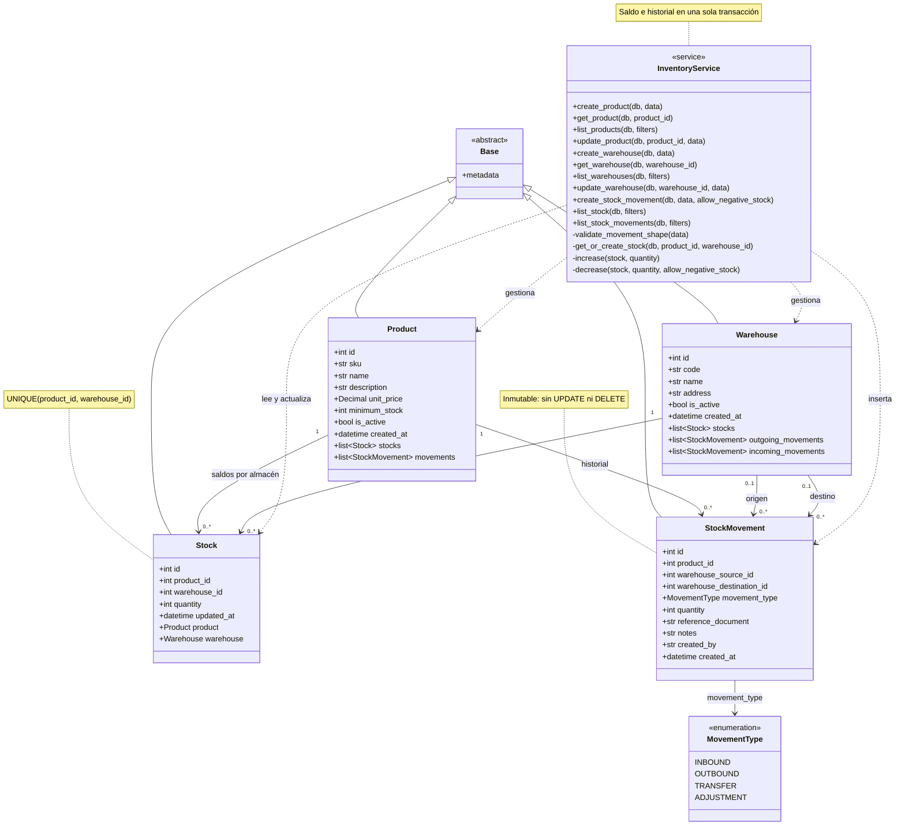
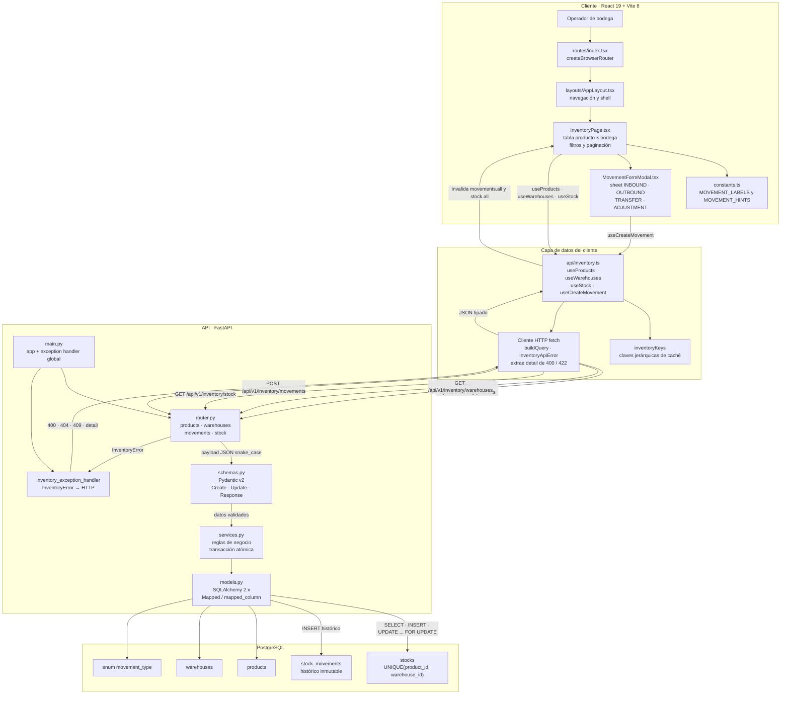
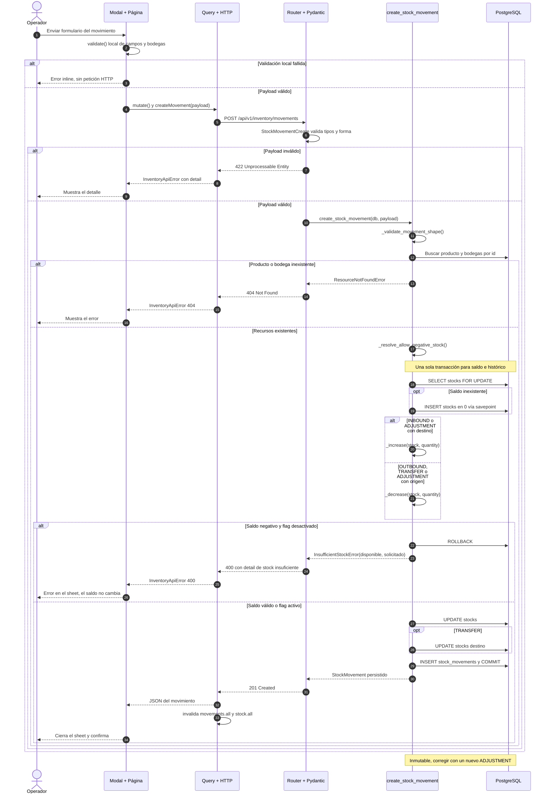

# Diagramas técnicos — Módulo `inventory`

Documentación visual del módulo de Inventario y Logística, derivada de
`specs/inventory_spec.md` y del código real de `backend/src/modules/inventory/`
y `frontend/src/modules/inventory/`.

| Diagrama | Qué responde |
| --- | --- |
| Clases | Qué entidades existen, cómo se relacionan y qué servicios las gobiernan |
| Componentes | Cómo viaja una petición desde React hasta PostgreSQL |
| Secuencia | Qué ocurre exactamente al registrar un movimiento y por qué se rechaza un stock negativo |

---

## 1. Diagrama de clases

Entidades SQLAlchemy (`models.py`), el enum `MovementType` y la capa de servicio
(`services.py`). Los tipos son los que expone el modelo ORM; `Decimal` proviene
de `Numeric(12, 2)` y todas las fechas son `DateTime(timezone=True)`.

### Lectura del diagrama

- **Cardinalidades reales.** `Stock` materializa el muchos-a-muchos entre
  `Product` y `Warehouse`; la unicidad `(product_id, warehouse_id)` impide
  duplicar saldos.
- **Dos relaciones opcionales hacia `Warehouse`.** `StockMovement` usa
  `warehouse_source_id` y `warehouse_destination_id`, ambos anulables: las
  entradas puras no tienen origen y las salidas puras no tienen destino.
- **`quantity > 0` siempre.** En `StockMovement` lo impone
  `ck_stock_movements_quantity_positive`; la dirección se expresa con
  `movement_type` y las bodegas, no con cantidades negativas.
- **`ADJUSTMENT` es incremental, no absoluto.** Con bodega de destino suma y con
  bodega de origen resta; la spec exige exactamente una de las dos.
- **Inmutabilidad.** No existe `StockMovementUpdate` en `schemas.py` ni endpoints
  `PATCH`/`DELETE`; los listeners `before_update` y `before_delete` lanzan
  `ImmutableMovementError` y la corrección se hace con un nuevo `ADJUSTMENT`.
- **`InventoryService`** agrupa las funciones de `services.py`; las marcadas con
  `-` son utilidades internas (lock de fila, aritmética de saldo y validación
  redundante de la forma del movimiento).

---

## 2. Diagrama de componentes

Arquitectura full-stack: vistas React → hooks de TanStack Query → cliente HTTP →
routers, esquemas Pydantic y servicios de FastAPI → tablas PostgreSQL.

### Lectura del diagrama

- **Una sola capa de datos en el cliente.** `InventoryPage` y
  `MovementFormModal` nunca llaman a `fetch` directamente: consumen hooks, y
  estos comparten `inventoryKeys` para invalidar caché de forma selectiva.
- **Contrato único.** Los tipos TypeScript replican en `snake_case` los esquemas
  Pydantic; el cliente HTTP traduce `{ "detail": "..." }` y las listas de
  validación 422 a un `InventoryApiError` legible.
- **Validación en dos capas.** Pydantic (`schemas.py`) valida tipos, longitudes y
  la forma del movimiento por tipo; `services.py` repite la validación de bodegas
  como defensa en profundidad para llamadas internas.
- **`main.py` centraliza el mapeo de errores.** `InventoryError` se traduce a
  404 (`ResourceNotFoundError`), 409 (`DuplicateResourceError`,
  `ImmutableMovementError`) o 400 (`InvalidMovementError`,
  `InsufficientStockError`).
- **El frontend no escribe en `stocks`.** Solo `create_stock_movement` modifica
  saldos; el cliente refresca vía invalidación de `stock.all`.

---

## 3. Diagrama de secuencia — registro de un movimiento

Flujo completo de `POST /api/v1/inventory/movements`, incluyendo validación
Pydantic, transacción atómica, bloqueo de stock negativo (HTTP 400) e
inmutabilidad del histórico.

### Lectura del diagrama

- **Doble validación de forma.** El cliente valida lo mínimo para dar feedback
  inmediato; Pydantic es la fuente de verdad del contrato y devuelve **422** con
  la lista de errores, mientras `services._validate_movement_shape` protege
  llamadas internas que no pasan por el router.
- **Reglas por tipo (`model_validator`).** `INBOUND` exige solo destino,
  `OUTBOUND` solo origen, `TRANSFER` ambos y distintos, y `ADJUSTMENT`
  exactamente una bodega. Un incumplimiento nunca llega a tocar `stocks`.
- **Atomicidad.** `_get_or_create_stock` usa `SELECT ... FOR UPDATE` para
  serializar movimientos concurrentes del mismo producto y bodega, y crea la
  fila en 0 dentro de un savepoint para tolerar carreras. El `UPDATE` de saldo y
  el `INSERT` del histórico se confirman en el mismo `COMMIT`; cualquier
  excepción ejecuta `db.rollback()`.
- **Bloqueo de stock negativo (escenario 2 de la spec).** `_decrease` calcula el
  saldo resultante; si es negativo y `ALLOW_NEGATIVE_STOCK` está desactivado,
  lanza `InsufficientStockError`, el router responde **400** con
  `detail: "Stock insuficiente ... disponible N, solicitado M"` y no se persiste
  ni el saldo ni el movimiento.
- **Transferencias sin deadlocks.** El servicio bloquea los saldos en orden
  ascendente de `warehouse_id`, de modo que dos transferencias cruzadas no se
  bloqueen mutuamente.
- **Inmutabilidad.** No hay `PATCH` ni `DELETE` sobre movimientos; los listeners
  `before_update` y `before_delete` lanzan `ImmutableMovementError` (409) y la
  única corrección admitida es un nuevo `ADJUSTMENT`.

---

## Referencias

- Contrato funcional: `specs/inventory_spec.md` (§2 entidades, §3 reglas, §4 API,
  §5 criterios de aceptación).
- Backend: `backend/src/modules/inventory/{models,schemas,services,router}.py`,
  `backend/src/core/database.py`, `backend/src/main.py`.
- Frontend: `frontend/src/modules/inventory/{InventoryPage,MovementFormModal,constants}.tsx`,
  `frontend/src/api/inventory.ts`, `frontend/src/routes/index.tsx`,
  `frontend/src/layouts/AppLayout.tsx`.
- Pruebas de aceptación: `backend/tests/test_inventory.py`.
