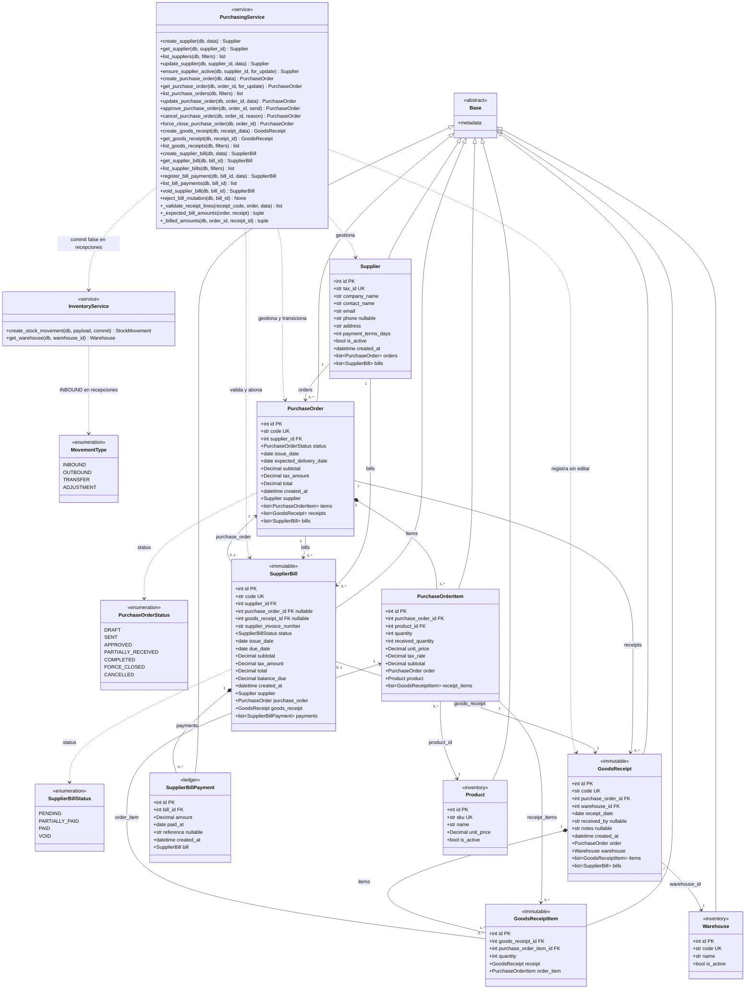
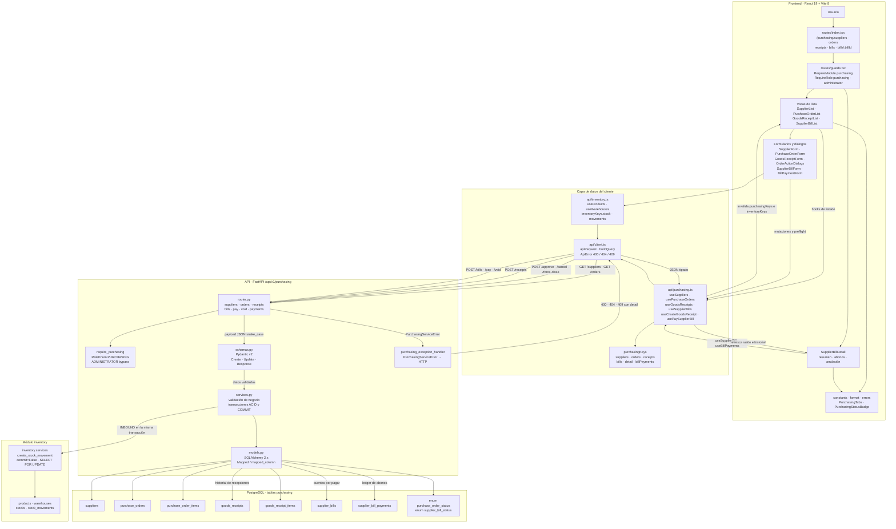
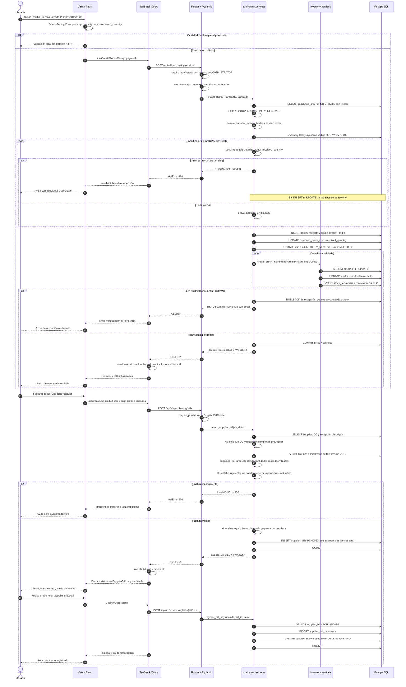

# Diagramas técnicos — Módulo `purchasing`

Documentación visual del módulo de Compras y Proveedores, derivada de
`specs/purchasing_spec.md` y del código final de
`backend/src/modules/purchasing/` y `frontend/src/modules/purchasing/`.

| Diagrama | Qué responde |
| --- | --- |
| Clases | Qué entidades SQLAlchemy existen, sus enums, relaciones y servicios de dominio |
| Componentes | Cómo viaja una petición desde React y TanStack Query hasta PostgreSQL e `inventory` |
| Secuencia | Qué ocurre al recibir mercancía, actualizar stock y registrar la factura del proveedor |

---

## 1. Diagrama de clases

Entidades SQLAlchemy (`models.py`), enums de estado, tipos de datos y servicios
de dominio (`services.py`). `Decimal` corresponde a `Numeric(14, 2)`,
`tax_rate` a `Numeric(5, 2)` y `MovementType` se reutiliza de `inventory`.
`SupplierBillPayment` es la extensión implementada para materializar el ledger
de abonos; `Product` y `Warehouse` pertenecen al catálogo de `inventory`.

### Reglas reflejadas en el modelo

- `PurchaseOrder` nace en `DRAFT`; solo `APPROVED` y `PARTIALLY_RECEIVED` admiten
  recepciones. La recepción total la lleva a `COMPLETED` y la parcial a
  `PARTIALLY_RECEIVED`; `FORCE_CLOSED` libera saldos pendientes y `CANCELLED`
  está prohibido si ya hay recepciones.
- `received_quantity` se acumula por línea y el `CHECK` de base de datos exige
  `0 <= received_quantity <= quantity`, respaldando la validación de
  sobre-recepción del servicio.
- `GoodsReceipt`, `GoodsReceiptItem`, `SupplierBill` y `SupplierBillPayment` son
  inmutables: los listeners ORM bloquean cambios y borrados; en una factura solo
  `status` y `balance_due` pueden cambiar al abonar o anular.
- `SupplierBill` exige al menos un documento origen (`purchase_order_id` o
  `goods_receipt_id`) y nace en `PENDING` con `balance_due = total`.
  `due_date` se deriva de `issue_date + supplier.payment_terms_days`.
- `ON DELETE RESTRICT` protege documentos comerciales y financieros;
  `CASCADE` solo aplica a las líneas dependientes de su documento.

---

## 2. Diagrama de componentes

Arquitectura full-stack: vistas React → guardias RBAC → hooks de TanStack Query
→ cliente HTTP → routers, esquemas y servicios de FastAPI → tablas PostgreSQL de
`purchasing` e `inventory`.

### Lectura del diagrama

- **Una sola capa de datos en el cliente.** Las vistas consumen hooks de
  `api/purchasing.ts`, que comparten `purchasingKeys` para invalidar caché de
  forma selectiva. El catálogo y las bodegas se leen con `api/inventory.ts`
  porque el rol `PURCHASING` solo tiene `inventory:read`.
- **Doble guardia RBAC.** `RequireModule` valida `allowed_modules` y
  `RequireRole` exige `purchasing` o `administrator`, igual que
  `require_purchasing` en el backend; evita abrir rutas que la API rechazaría
  con 403.
- **Contrato único.** Los tipos TypeScript replican en `snake_case` los
  esquemas Pydantic. Los importes `Decimal` viajan como string para no perder
  precisión; las vistas calculan en centavos.
- **Inventario participa en la misma transacción.** `create_goods_receipt`
  llama a `create_stock_movement(..., commit=False)`; el `COMMIT` final lo hace
  `services.py`, de modo que no quedan recepciones ni stocks parciales.
- **Los errores de dominio se traducen en el router.** Sobre-recepción,
  proveedor/producto inactivo e importe inválido son 400; estado inválido es
  409; recurso ausente es 404.

---

## 3. Diagrama de secuencia — recepción, stock y facturación

Flujo completo desde la acción **Recibir** (`/receive`) sobre una orden
aprobada hasta el registro de la factura del proveedor. Incluye la validación
de sobre-recepción, la transacción ACID que incrementa el stock de `inventory`,
el rechazo HTTP 400 sin escrituras parciales y la validación financiera de la
factura contra costos pactados y cantidades realmente recibidas.

### Puntos críticos del flujo

- **Sobre-recepción atómica.** Si una línea supera su pendiente, se responde
  400 antes de cualquier escritura: no quedan `GoodsReceipt`, acumulados,
  movimientos ni stock parcial.
- **ACID de extremo a extremo.** Recepciones, acumulados, transición de la OC y
  movimientos `INBOUND` se confirman con un único `COMMIT`. El saldo se bloquea
  con `SELECT FOR UPDATE` dentro de `inventory`.
- **Facturación consistente.** La factura nace `PENDING` con
  `balance_due = total`; el backend valida proveedor, costos pactados, tasa
  impositiva y saldo pendiente descontando facturas no `VOID`.
- **Inmutibilidad financiera y logística.** No se editan recepciones ni
  facturas: los ajustes son nuevos abonos, anulaciones `VOID` o movimientos de
  inventario de contrapartida. `PATCH` y `DELETE` responden 400.
- **Coherencia de caché.** Registrar la recepción invalida también
  `inventoryKeys.stock` y `inventoryKeys.movements`; abonar refresca el
  detalle, el listado y el historial de la factura.
