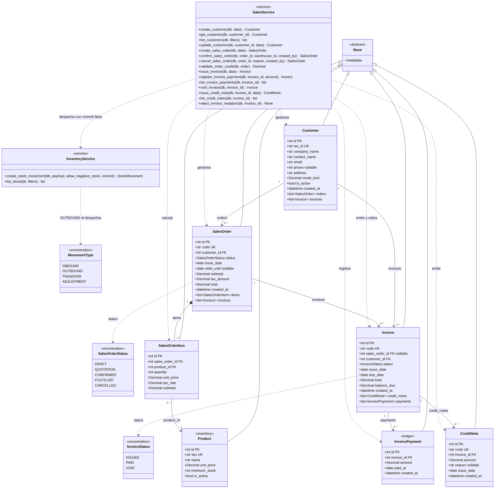
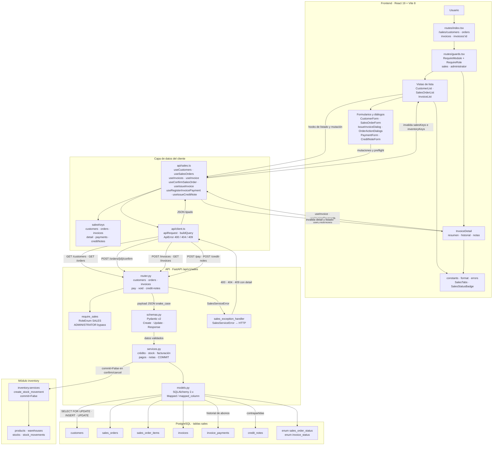
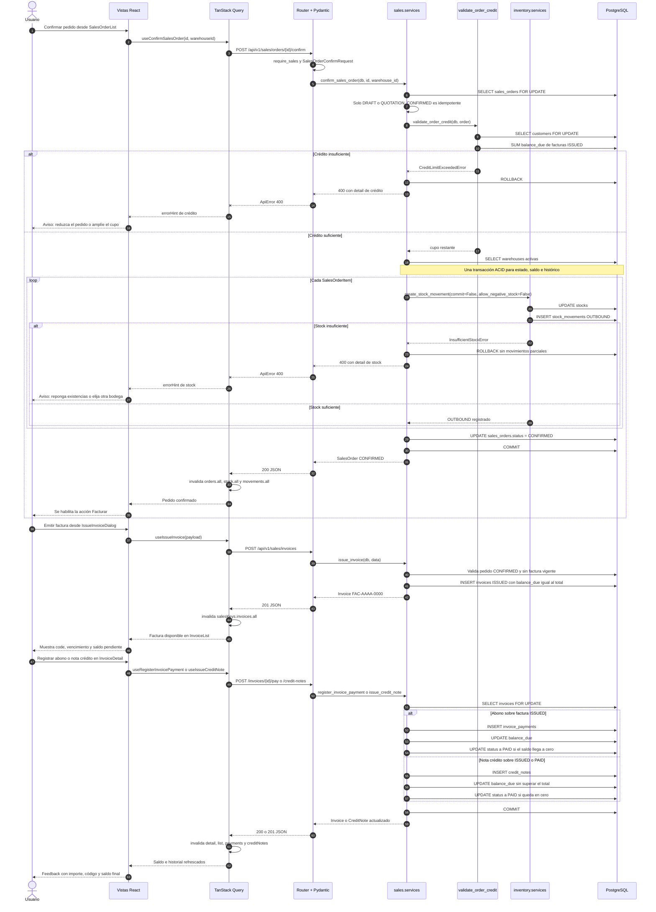

# Diagramas técnicos — Módulo `sales`

Documentación visual del módulo de Ventas y Facturación, derivada de
`specs/sales_spec.md` y del código final de `backend/src/modules/sales/` y
`frontend/src/modules/sales/`.

| Diagrama | Qué responde |
| --- | --- |
| Clases | Qué entidades SQLAlchemy existen, sus enums, relaciones y servicios |
| Componentes | Cómo viaja una petición desde React y TanStack Query hasta PostgreSQL e `inventory` |
| Secuencia | Qué ocurre al confirmar un pedido, facturarlo y registrar abonos o notas crédito |

---

## 1. Diagrama de clases

Entidades SQLAlchemy (`models.py`), enums de estado, servicios de dominio
(`services.py`) y el servicio de inventario que participa en el despacho.
`Decimal` corresponde a `Numeric(14, 2)`; `InvoicePayment` es la extensión
implementada para materializar el historial de abonos.

### Reglas reflejadas en el modelo

- `sales_order_items.sales_order_id` usa `ON DELETE CASCADE`: las líneas son
  dependientes del pedido mientras este sigue en borrador o cotización.
- Las demás claves foráneas usan `RESTRICT`: clientes, pedidos, facturas,
  abonos y notas crédito conservan el historial comercial.
- `SalesOrder` calcula `subtotal`, `tax_amount` y `total` desde sus líneas;
  `Invoice` nace con `balance_due = total` y solo lo reducen pagos o notas.
- `MovementType.OUTBOUND` es el vínculo con `inventory`; la cancelación de un
  pedido `CONFIRMED` genera un `INBOUND` de reversión sin borrar el salida
  original.

---

## 2. Diagrama de componentes

Arquitectura full-stack: vistas React → guardias RBAC → hooks de TanStack Query
→ cliente HTTP → routers, esquemas y servicios de FastAPI → tablas PostgreSQL
de `sales` e `inventory`.

### Lectura del diagrama

- **Una sola capa de datos en el cliente.** Las vistas nunca llaman a `fetch`
  directamente: consumen hooks de `api/sales.ts`, que comparten `salesKeys`
  para invalidar caché de forma selectiva.
- **Doble guardia RBAC.** `RequireModule` valida `allowed_modules` y
  `RequireRole` exige `sales` o `administrator`, igual que `require_sales` en
  el backend; evita abrir rutas que la API rechazaría con 403.
- **Contrato único.** Los tipos TypeScript replican en `snake_case` los
  esquemas Pydantic. `Decimal` viaja como string para no perder precisión.
- **Inventario participa en la misma transacción.** `confirm_sales_order`
  llama a `create_stock_movement(..., commit=False)`; el `COMMIT` final lo hace
  `services.py`, de modo que no quedan salidas parciales.
- **Los errores de dominio se traducen en el router.** Crédito insuficiente y
  stock insuficiente son 400; estado inválido es 409; recurso ausente es 404.

---

## 3. Diagrama de secuencia — confirmación, facturación y cobros

Flujo completo desde la confirmación de un pedido hasta el registro de abonos y
notas crédito. Incluye la validación de crédito, la transacción ACID que
descuenta `stocks` y escribe `stock_movements`, el rechazo HTTP 400 por crédito
o stock insuficiente, la emisión de la factura y la actualización del saldo.

### Puntos críticos del flujo

- **Idempotencia.** Un pedido ya `CONFIRMED` se devuelve sin descontar stock
  otra vez; el bloqueo `FOR UPDATE` se libera con `ROLLBACK`.
- **ACID.** Si falla una línea por falta de stock, se revierte el cambio de
  estado y no queda ningún `OUTBOUND` parcial. El error se convierte en 400.
- **Inmutabilidad financiera.** La factura no se edita: los ajustes se registran
  como `InvoicePayment` o `CreditNote`, y `PATCH`/`DELETE` responden 400.
- **Coherencia de caché.** Confirmar invalida inventario; abonar o acreditar
  invalida el detalle, el listado y el historial de la factura.
