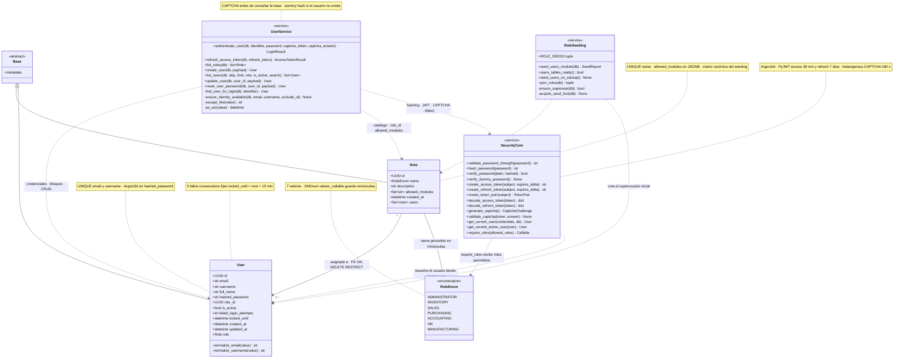
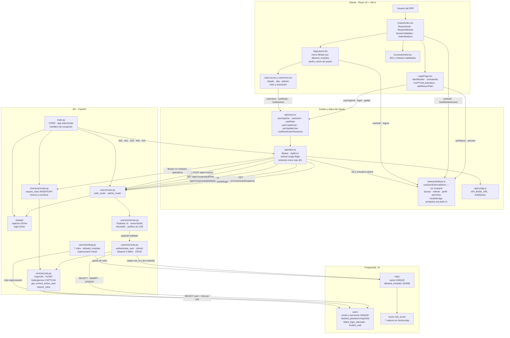
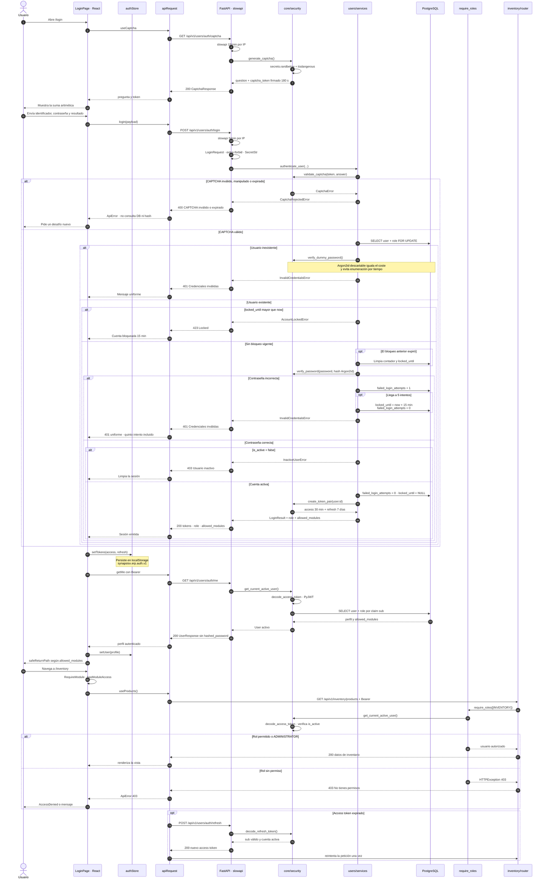

# Diagramas técnicos — Módulo `users`, roles y seguridad

Documentación visual del módulo de Usuarios, Roles y Seguridad, derivada de
`specs/users_spec.md` y del código real de `backend/src/modules/users/`,
`backend/src/core/security.py` y `frontend/src/` (autenticación, guardias y
administración).

| Diagrama | Qué responde |
| --- | --- |
| Clases | Qué entidades existen, cómo se relacionan y qué servicios gobiernan credenciales, bloqueo y módulos permitidos |
| Componentes | Cómo viaja una petición desde React y el store de sesión hasta FastAPI, el núcleo de seguridad y PostgreSQL |
| Secuencia | Qué ocurre desde el CAPTCHA hasta la autorización de un módulo, incluyendo bloqueo, anti-timing y RBAC |

> **Nota de implementación:** el frontend no usa Zustand. La sesión vive en
> `frontend/src/store/authStore.ts`, un store propio basado en
> `useSyncExternalStore` y persistido en `localStorage`. El diagrama de
> componentes refleja esa decisión real.

---

## 1. Diagrama de clases

Entidades SQLAlchemy (`models.py`), el enum `RoleEnum`, la capa de servicio
(`services.py`), el núcleo de seguridad (`core/security.py`) y el seeding
canónico de roles (`seeding.py`). Los tipos corresponden al modelo ORM:
`UUID` para claves primarias y foráneas, `datetime` con zona horaria,
`JSONB` para `allowed_modules` y `str` para el hash Argon2id.

### Lectura del diagrama

- **`Role` es el catálogo autoritativo.** `allowed_modules` es una lista JSONB
  (`["inventory", "inventory:read", ...]`) que el seeding sincroniza en cada
  arranque; el sufijo `:read` habilita navegación de lectura sin escritura.
- **`RoleEnum` es estable y legible.** Los miembros Python van en mayúsculas,
  pero `values_callable` persiste `administrator`, `inventory`, `sales`, etc.,
  de modo que el enum nativo de PostgreSQL coincide con el contrato de la spec.
- **`User` concentra identidad y defensa.** `email` y `username` son únicos e
  indexados; `hashed_password` guarda Argon2id; `failed_login_attempts` y
  `locked_until` implementan el bloqueo temporal de 15 minutos tras 5 fallos.
- **`UserService.authenticate_user`** valida el CAPTCHA **antes** de consultar
  la base, busca por correo o usuario con `SELECT ... FOR UPDATE`, aplica el
  bloqueo, verifica el hash, reinicia el contador en éxito y emite el par de
  tokens. `verify_dummy_password()` cubre al usuario inexistente.
- **`UserService` también administra el ciclo de vida.** `create_user` valida
  el `role_id`, normaliza el correo y hashea la contraseña; `update_user` aplica
  solo los campos enviados; `reset_user_password` vuelve a hashear y limpia
  `failed_login_attempts`/`locked_until` para desbloquear la cuenta.
- **`SecurityCore.require_roles`** es la frontera de autorización: exige un
  usuario activo y permite el paso si su rol está en la lista o si es
  `ADMINISTRATOR` (bypass de superusuario).
- **`RoleSeeding`** mantiene la matriz canónica: crea los roles ausentes,
  actualiza descripción y `allowed_modules` si difieren y garantiza el
  superusuario inicial sin resetear su contraseña si ya existe.

---

## 2. Diagrama de componentes

Arquitectura full-stack: vistas React y guardias → store de sesión y hooks de
TanStack Query → cliente HTTP con Bearer y refresh → routers, esquemas Pydantic
y servicios FastAPI (con `slowapi`) → núcleo de seguridad (`Argon2id`, `PyJWT`,
`itsdangerous`) → tablas PostgreSQL. Incluye el router de inventario como
consumidor real de `require_roles`.

### Lectura del diagrama

- **El store es la fuente de sesión del cliente.** Guarda `accessToken`,
  `refreshToken` y el perfil con su rol y `allowed_modules`. Las guardias y el
  menú lo consumen, pero la autorización real sigue estando en FastAPI.
- **Un único cliente HTTP.** `apiRequest` añade el Bearer, traduce los errores a
  `ApiError` y, ante un 401, comparte una sola promesa de refresh para reintentar
  la petición original una vez. Si el refresh falla, limpia la sesión.
- **El CAPTCHA es stateless.** `itsdangerous` firma `{answer, nonce}`; el
  backend no guarda desafíos en base de datos ni en memoria.
- **`slowapi` protege la fuerza bruta y el abuso.** `GET /auth/captcha` admite
  15 peticiones/minuto y `POST /auth/login`, 5/minuto, ambos por IP remota.
- **Pydantic es el contrato de entrada.** `extra="forbid"` bloquea asignación
  masiva (`role`, `is_active`, `hashed_password`, etc.), `SecretStr` evita
  filtrar credenciales en logs y `StrongPassword` aplica la política 10–128.
- **El núcleo de seguridad es transversal.** Inventario y usuarios comparten
  `require_roles`; el primero lo usa para distinguir lectura/escritura y el
  segundo para restringir toda la administración a `ADMINISTRATOR`.
- **PostgreSQL materializa el contrato.** `role_enum` es un enum nativo,
  `allowed_modules` es JSONB, `users.email`/`users.username` son únicos y la FK
  `role_id` usa `ON DELETE RESTRICT` para no dejar cuentas sin rol.
- **El seeding es idempotente.** Se ejecuta en el `lifespan` de FastAPI y
  sincroniza la matriz canónica de roles sin tocar los datos de inventario.

---

## 3. Diagrama de secuencia — autenticación, bloqueo y autorización

Flujo completo desde `GET /api/v1/users/auth/captcha`, pasando por
`POST /api/v1/users/auth/login` con CAPTCHA, bloqueo anti-fuerza bruta y
protección anti-timing, hasta la evaluación de `require_roles` en el acceso a
un módulo del ERP.

### Lectura del diagrama

- **El CAPTCHA se valida primero.** Si la firma, la antigüedad o la suma fallan,
  el flujo termina en 400 antes de consultar la base o el hash; un CAPTCHA
  rechazado no incrementa `failed_login_attempts`.
- **La búsqueda bloquea la fila.** `SELECT ... FOR UPDATE` serializa intentos
  concurrentes sobre el mismo usuario en PostgreSQL. En SQLite de pruebas el
  bloqueo se ignora de forma segura.
- **Anti-enumeración y anti-timing.** Usuario inexistente y contraseña
  incorrecta devuelven el mismo 401 (`Credenciales inválidas`); el primero
  ejecuta `verify_dummy_password()` para igualar el coste Argon2id.
- **Bloqueo real, no solo cosmético.** El quinto fallo fija
  `locked_until = now + 15 min` y reinicia el contador; ese quinto intento aún
  responde 401 uniforme y el siguiente responde **423 Locked**, incluso con la
  contraseña correcta. Al expirar, el estado se limpia antes de verificar.
- **La cuenta inactiva se distingue solo tras verificar la contraseña.** Así no
  se revela la existencia de una cuenta deshabilitada a quien no conoce la
  credencial.
- **Tokens con claims estrictos.** `PyJWT` exige `sub`, `type`, `iat` y `exp`;
  el access dura 30 minutos y el refresh 7 días. El frontend persiste ambos en
  `localStorage` (riesgo XSS asumido y documentado).
- **La guardia visual no sustituye al backend.** `RequireModule` oculta/bloquea
  rutas según `allowed_modules`, pero `require_roles` vuelve a validar el rol
  en FastAPI. Un `ADMINISTRATOR` pasa siempre por bypass.
- **Renovación transparente.** Ante un access token expirado, `apiRequest`
  comparte un único refresh, reintenta la petición una sola vez y limpia la
  sesión si el refresh falla. Un `403 {"detail":"Usuario inactivo"}` también
  cierra la sesión.

---

## Referencias

- Contrato funcional: `specs/users_spec.md` (§2 stack, §3 entidades, §4
  seguridad, §5 API, §6 escenarios OWASP).
- Backend: `backend/src/modules/users/{models,schemas,services,router,seeding}.py`,
  `backend/src/core/security.py`, `backend/src/core/config.py`,
  `backend/src/main.py`.
- Frontend: `frontend/src/store/authStore.ts`, `frontend/src/api/{client,config,users}.ts`,
  `frontend/src/modules/users/{LoginPage,UserList,UserForm,constants}.tsx`,
  `frontend/src/routes/{index,guards,modules,AccessDenied,ModulePlaceholder}.tsx`,
  `frontend/src/layouts/AppLayout.tsx`.
- Pruebas: `backend/tests/test_users_security.py` (7 escenarios OWASP),
  `test_users_security_core.py`, `test_users_auth_flow.py`,
  `test_users_admin.py` y `test_users_seeding.py`.
- Bitácora: `memory/users_memory.md`, `MEMORY.md`.
